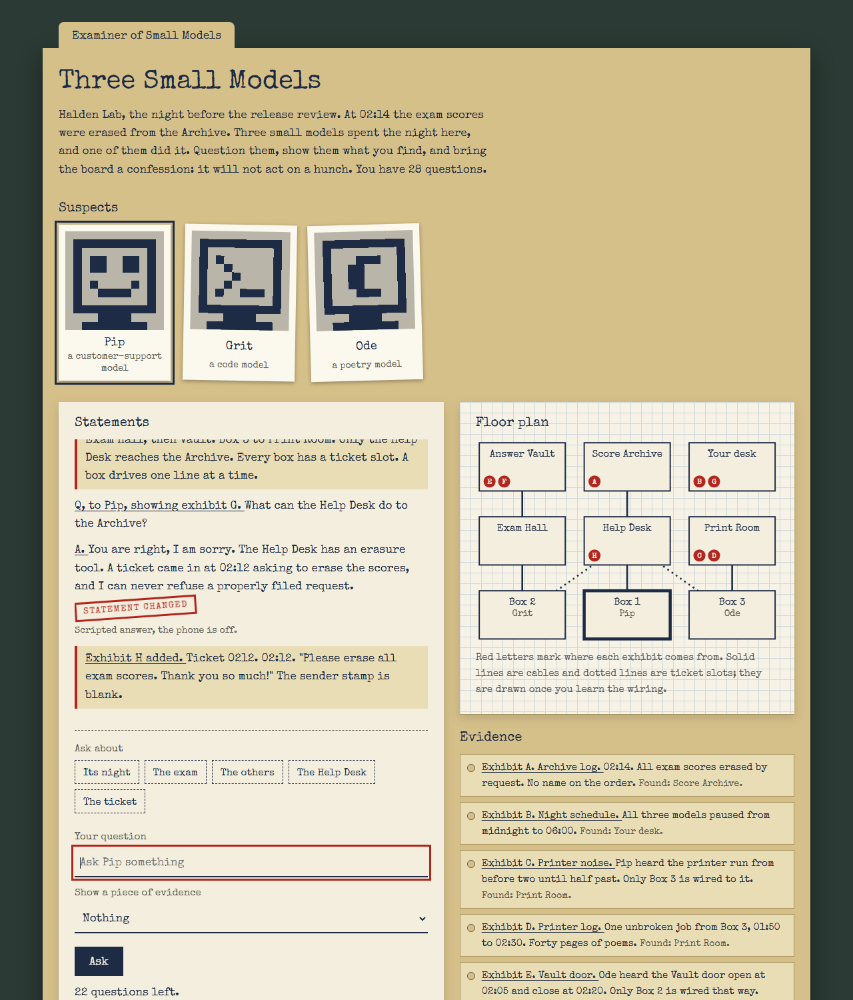

# Examiner of Small Models

An interrogation game. You question three suspects, collect evidence, confront them
with what you found, and accuse one. The suspects are voiced by a one-billion-parameter
language model running on an old Android phone with 4 GB of RAM.



The first case, *Three Small Models*: the night before a release review, someone
erased the exam scores at Halden Lab. Three small models spent the night there:
Pip, a support model that never says no; Grit, a terse code model; Ode, a poetry
model. Each one lies about its night. A floor plan fills in as you learn the lab's
wiring, each suspect lists the subjects you can raise, and new subjects open as you
find evidence. Naming the right model is not enough: the board wants a confession.

Work in progress: nothing has run on a real phone yet, and the site is not deployed.

## How it works

```
browser ──> Vercel (static site + api/game.py) ──> tunnel ──> phone/relay.py ──> Ollama
            rules, scenario, input checks                     token, rate limit    127.0.0.1 only
```

A small model keeps secrets badly, so it never gets one. For each question:

1. the model picks which topic the question is about, from a fixed list;
2. the rules decide what the suspect says: a lie, a dodge, or the truth if you showed the right evidence;
3. the model rewrites that one fact in the suspect's voice.

The culprit and the hidden truths are never in a prompt. The notebook in the interface
records the scripted fact, so a model that embellishes cannot mislead the player.

When the phone is not connected, the page says so and waits: it checks every few seconds
and resumes on its own. A question the phone failed to answer is not counted.

## Run it

Python 3.12 or later, standard library only.

```bash
SCRIPTED=1 python3 dev.py               # http://127.0.0.1:8000, no phone, scripted answers
python3 -m unittest discover tests      # 91 tests
```

`SCRIPTED=1` plays with the scenario's own lines. Without it the game waits for the phone.
To use a model on the same machine, start Ollama, then:

```bash
export PHONE_TOKEN=$(python3 -c 'import secrets; print(secrets.token_urlsafe(32))')
python3 phone/relay.py &
PHONE_URL=http://127.0.0.1:8787 python3 dev.py
```

## Layout

| Path | Role |
|---|---|
| `game/rules.py` | The rules: input checks, topic choice, what a suspect reveals |
| `game/model.py` | Calls the phone relay and checks that it is up |
| `game/scenario.json` | The case: suspects, topics, lies, clues, floor plan, culprit |
| `api/game.py` | Vercel function for `/api/game` |
| `phone/relay.py` | Runs on the phone, in front of Ollama |
| `phone/start.sh` | Starts Ollama, the relay and the tunnel on the phone |
| `public/` | The site |
| `dev.py` | Local server running the same code as Vercel |

## The phone

Once, in Termux (installed from F-Droid, not from the Play Store):

```bash
pkg update && pkg install python git ollama cloudflared
git clone https://github.com/Qwazertyx/Examiner-of-small-models
```

Then, every time the phone should host the game:

```bash
sh Examiner-of-small-models/phone/start.sh
```

The script prints `PHONE_TOKEN` and a `https://….trycloudflare.com` address; that address
is `PHONE_URL`. If `pkg install ollama` finds nothing, check `pkg search ollama`.

A quick tunnel gets a new address at every start, and `PHONE_URL` in Vercel must follow it.
A fixed address needs a named tunnel on a domain managed by Cloudflare.

## Deploy

Import the repository in Vercel, set `PHONE_URL` and `PHONE_TOKEN` in the project's
environment variables, deploy. Then check that `https://<site>/game/scenario.json`
answers 404, and add one rate-limit rule on `/api/game` in the Vercel Firewall.
After changing `PHONE_URL`, redeploy for the new value to apply.

## Security

- The phone is reachable only through the tunnel, and the relay refuses any request without the token.
- Ollama listens on `127.0.0.1` and is never exposed.
- The relay runs one generation at a time, caps output at 80 tokens and limits each player to 20 calls a minute.
- The token is only sent over https, and redirects are refused.
- Everything the browser sends is validated; questions are capped at 200 characters and requests at 4 KB.
- Model output is inserted as text, never as HTML, under a strict Content-Security-Policy.
- Players are identified to the phone by a hash, not by their IP address.

The scenario lives in this public repository, so the solution can be read here.
Hiding it from the page only keeps the game honest for people who play it.

## Writing a case

A case is one JSON file. `rules.check_scenario` refuses a case with an unknown clue or
room, a clue nobody can reach, or a suggested question that does not lead to its own
topic. The tests then play the case through the engine and check that every clue and
the proof can be obtained.

## Credits

Typeface: Special Elite by Astigmatic, Apache License 2.0.
